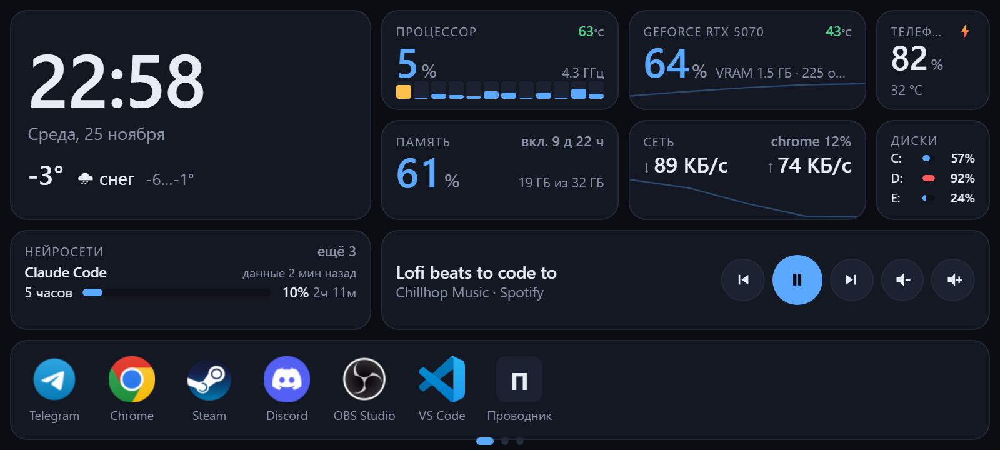
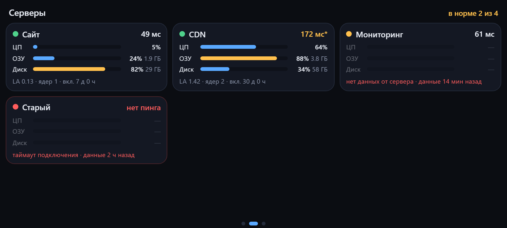
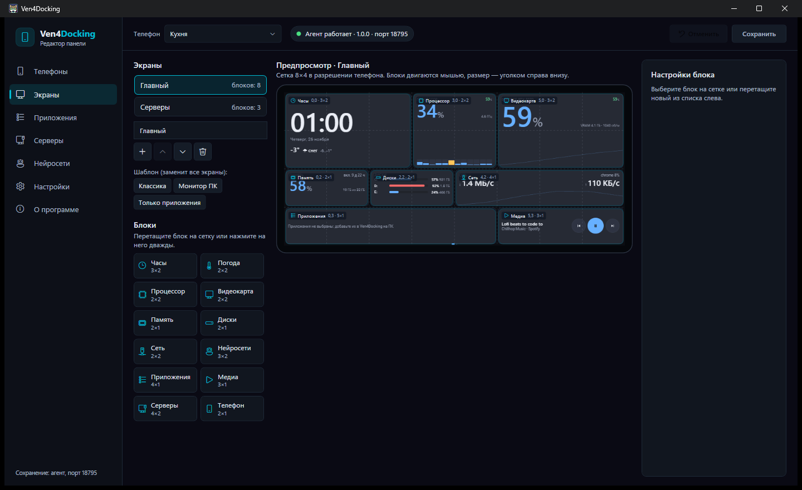

<p align="center"></p>

<h1 align="center">Ven4Docking</h1>

<p align="center">Старый Android-телефон → настенная тач-панель вашего ПК.<br>
<a href="#english">English below</a></p>

---

## Что это

Ven4Docking превращает старый телефон на Android в постоянно включённую панель рядом с компьютером:
часы и погода, загрузка процессора и видеокарты, память, диски, сеть, что сейчас играет, состояние ваших серверов,
лимиты нейросетей, кнопки запуска приложений и медиакнопки. Экраны листаются свайпом, ночью панель приглушается.

<p align="center"></p>
<p align="center"></p>
<p align="center"></p>

Состоит из трёх частей:

- **Агент** (`ven4docking-agent.exe`) — работает в фоне со значком в трее, собирает данные и раздаёт панель телефону. Почти не нагружает ПК: опрашивает только то, что есть на экранах телефона.
- **Редактор** (`Ven4Docking.exe`) — настройка экранов, блоков, приложений, серверов и мастер подключения телефона. Нужен редко, закрывается полностью.
- **Лаунчер** на телефоне (`ru.ven4tools.docking`) — показывает панель на весь экран и сам обновляется с ПК.

## Требования

- Windows 10 или 11 (64 бит).
- Телефон на Android 7.0 или новее.
- ПК и телефон в одной домашней сети: телефон по Wi-Fi, ПК — по Wi-Fi или кабелем к тому же роутеру.
- Для мастера настройки — USB-кабель (рекомендуется) или Wi-Fi-отладка (Android 11+).

## Установка

1. Скачайте `Ven4Docking-Setup-X.Y.Z.exe` со страницы [Releases](https://github.com/Ven4ru/Ven4Docking/releases) и запустите.
2. Программа ставится только для вашей учётной записи в `%LOCALAPPDATA%\Programs\Ven4Docking`, права администратора не нужны.
3. Один раз Windows спросит права администратора — для правила брандмауэра «Ven4Docking» (входящие TCP 8765 и UDP 8766, только из локальной подсети). Если отказать, программа установится и будет работать, но телефон не сможет достучаться до ПК; правило можно добавить позже, запустив установщик ещё раз.
4. Агент добавляется в автозапуск (его можно выключить в редакторе: «Настройки»), редактор — в меню «Пуск».

Удаление — через «Параметры» → «Приложения». Настройки (`%APPDATA%\Ven4Docking`) остаются, если не отметить «Удалить настройки».

## Первый запуск

1. Откройте редактор → «Телефоны» → «Подключить телефон». Запустится мастер.
2. **По кабелю надёжнее.** Через USB ПК всегда может обновить лаунчер и вернуть настройки телефона. Wi-Fi-отладка выключается после перезагрузки телефона или смены сети. Без отладки всё, что делает мастер, придётся настроить на телефоне вручную.
3. Мастер подскажет, как включить отладку именно на вашей марке телефона, скачает Android platform-tools (`adb`) с `dl.google.com` — только с вашего согласия, — установит лаунчер, настроит экран и фон и привяжет телефон к ПК.
4. Без кабеля: установите лаунчер, на телефоне выберите найденный ПК (или введите адрес) — на экране появится код из 4 цифр; подтвердите его в редакторе в «Телефонах».

## Экраны, блоки и приложения

- **Экраны** — у каждого телефона до 10 экранов, сетка 8×4. Перетащите блок из палитры, двигайте и растягивайте его, справа — настройки блока. «Сохранить» — и панель на телефоне перестроится без перезагрузки. Блоки не могут пересекаться — редактор подсветит ошибку.
- **Блоки:** часы, погода, процессор, видеокарта, память, диски, сеть, нейросети, приложения, медиа, серверы, телефон (заряд и температура), питание, кнопки, микшер, OBS, уведомления. Любой блок можно поставить несколько раз или не ставить совсем.
- **Приложения** — добавляются из меню «Пуск», как exe-файл, ссылка или команда с параметрами; значки извлекаются сами, порядок меняется перетаскиванием. Телефон может запускать только то, что есть в этом списке.
- **Кнопки** — сочетания клавиш, заготовленный текст, цепочки шагов (клавиши, текст, паузы, запуск приложения), выключение микрофона и переключение вывода звука (наушники ↔ колонки). Есть готовый шаблон для Discord. Нажатия не доходят до окон, запущенных от имени администратора, и часть игр с античитом их не принимает.
- **Питание** — блокировка, сон, перезагрузка и выключение; кнопку нужно удерживать 2 секунды, у перезагрузки и выключения есть 10 секунд на отмену. Если ПК выключен, на телефоне есть кнопка «Включить ПК» (Wake-on-LAN: надёжнее по кабелю, включение по сети должно быть разрешено в BIOS/UEFI).
- **Экраны программ** — экран можно привязать к программе (например, `obs64.exe`): пока она запущена, на панели появляется плашка «открыть». Для OBS есть свой блок: стрим и запись, сцены, звук источников, потерянные кадры (через встроенный в OBS 28+ WebSocket; пароль хранится зашифрованным средствами Windows).
- **Уведомления** — уведомления Windows на панели только от выбранных приложений; для каждого — счётчик, заголовок или текст целиком, общий режим «на стене только счётчики».
- **Серверы** — по SSH с вашим ключом из `%USERPROFILE%\.ssh` и проверкой `known_hosts`; «Проверить подключение» объясняет ошибку понятными словами.
- **Настройки** — тема (как у Ven4Tools), язык (русский/английский), город для погоды, автозапуск агента, порт, OBS, включение по сети.
- **Обновления** — агент раз в сутки проверяет выпуски на GitHub и сообщает о новой версии; редактор ставит её по кнопке (с проверкой контрольной суммы), а телефон получает новый лаунчер с ПК.

## Приватность

- Никакой телеметрии и аналитики.
- Сеть наружу — только: [open-meteo.com](https://open-meteo.com) (погода и поиск города), GitHub Releases (проверка обновлений), `dl.google.com` (platform-tools, только с согласия), SSH к вашим собственным серверам.
- Агент отвечает только устройствам из локальной сети; телефон входит по своему токену (на ПК хранится только хеш). API редактора доступен только с самого ПК (`127.0.0.1`) по ключу из `%APPDATA%\Ven4Docking\admin.key`.
- Уведомления Windows агент читает, только если вы включили это в редакторе (по умолчанию выключено), и отдаёт только привязанным телефонам и только от выбранных приложений; текст — лишь там, где вы это разрешили.
- Все настройки и журналы — в `%APPDATA%\Ven4Docking` на вашем ПК.

### Модуль нейросетей

Блок «Нейросети» читает **только локальные файлы, которые официальные программы сами пишут на диск**, и локальные API без входа в аккаунт: строку состояния Claude Code (только если вы сами разрешите это в редакторе), историю использования Claude Desktop, журналы сессий Codex, загруженные модели Ollama и LM Studio. Ven4Docking не читает токены, cookie и файлы входа и не обращается к закрытым адресам сервисов — такого кода в программе нет, и это проверяет автоматический тест. Поэтому способ не может привести к блокировке вашего аккаунта. Для остальных программ показывается только «установлено, лимиты недоступны».

## Сборка из исходников

Нужны: Rust (stable), Node.js 20+, .NET 10 SDK, JDK 17+ и Android SDK (`ANDROID_HOME`), NSIS 3.

```powershell
./build.ps1          # агент, панель, редактор, APK, установщик и zip -> dist\
./build.ps1 -Test    # то же + cargo test, npm run lint, dotnet test, тесты лаунчера (JVM)
```

Результат: `dist\Ven4Docking-Setup-X.Y.Z.exe`, `dist\Ven4Docking-X.Y.Z.zip` (копия установленной папки), `dist\ven4docking-launcher-X.Y.Z.apk`, `dist\SHA256SUMS`.
Локальный APK подписан отладочным ключом. Выпуски для пользователей собираются только в GitHub Actions (`.github/workflows/build.yml`).

Структура: `agent/` — агент (Rust), `editor/` — редактор (WPF, .NET 10), `panel/` — страница панели (JS, цель — WebView Android 7), `android/` — лаунчер (Java), `installer/` — установщик NSIS, `assets/icon/` — иконка (исходник 1024 px, `tools/make_icons.py` делает из него `.ico` и значки Android).

Для разработки рядом с уже работающим агентом: `VEN4DOCKING_HOME` — отдельная папка данных, `VEN4DOCKING_PORT` — другой порт (отладочная сборка лаунчера ищет агент на 18765/18766).

## Частые вопросы

**Телефон не загружается / нужна прошивка. Есть прошивка под Ven4Docking?**
Нет. Ven4Docking — приложение, а не прошивка: ему нужен телефон с работающим Android 7.0 или новее. Если Android не загружается,
телефон сначала нужно восстановить — заводской прошивкой производителя или, например, LineageOS для вашей модели. Это делается
на ваш страх и риск, с прошивкой мы не помогаем. Когда телефон загрузится — подключайте его мастером.

**На телефоне Android 6 или старше.**
Не поддерживается: встроенный браузер страниц (WebView) там слишком старый.

**Что будет, когда ПК выключен?**
Панель пишет «ПК не отвечает», приглушает экран и сама оживает, когда ПК снова в сети и вы вошли в Windows.
Если роутер выдал ПК новый адрес, телефон сам найдёт его в домашней сети.

**Почему экран ночью тусклый?**
Это ночной режим панели (по умолчанию 23:00–07:00). Часы и яркость меняются в редакторе: «Телефоны» → «Ночь и яркость».

## Лицензия

[MIT](LICENSE) © Ven4ru

## Семейство Ven4verse

Ven4Docking — часть семейства Ven4verse: [ven4tools.ru](https://ven4tools.ru).

---

<a id="english"></a>

## English

**Ven4Docking turns an old Android phone into a wall-mounted touch panel for your PC:** clock and weather, CPU/GPU load,
memory, disks, network, now playing, the state of your servers, AI usage limits, app launch buttons and media keys.
Screens are swiped, the panel dims at night.

Three parts:

- **Agent** (`ven4docking-agent.exe`) — runs in the background with a tray icon, collects data and serves the panel to the phone. Very light: it polls only what the phone's screens show.
- **Editor** (`Ven4Docking.exe`) — screens, blocks, apps, servers and the phone setup wizard. Needed rarely, closes completely.
- **Launcher** on the phone (`ru.ven4tools.docking`) — shows the panel full screen and updates itself from the PC.

### Requirements

- Windows 10 or 11 (64-bit).
- A phone with Android 7.0 or newer.
- PC and phone on the same home network: the phone on Wi-Fi, the PC on Wi-Fi or wired to the same router.
- For the setup wizard: a USB cable (recommended) or Wireless debugging (Android 11+).

### Install

1. Download `Ven4Docking-Setup-X.Y.Z.exe` from [Releases](https://github.com/Ven4ru/Ven4Docking/releases) and run it.
2. It installs for your user only into `%LOCALAPPDATA%\Programs\Ven4Docking`; no administrator rights needed.
3. Windows asks for administrator rights once — for the firewall rule "Ven4Docking" (inbound TCP 8765 and UDP 8766, local subnet only). If you decline, the program still installs and runs, but the phone cannot reach the PC; run the installer again later to add the rule.
4. The agent starts with Windows (switch it off in the editor: Settings); the editor is in the Start menu.

Uninstall via Settings → Apps. Your settings (`%APPDATA%\Ven4Docking`) are kept unless you tick "Remove settings".

### First run

1. Open the editor → Phones → Connect a phone. The wizard starts.
2. **A cable is more reliable.** Over USB the PC can always update the launcher and restore the phone settings. Wireless debugging turns off after a phone reboot or a network change. Without debugging, everything the wizard does has to be set up on the phone by hand.
3. The wizard explains how to enable debugging on your phone brand, downloads Android platform-tools (`adb`) from `dl.google.com` — only with your consent — installs the launcher, sets up the screen and background behaviour and pairs the phone.
4. Without a cable: install the launcher, pick the PC it finds (or type its address) — the phone shows a 4-digit code; confirm it in the editor under Phones.

### Screens, blocks and apps

- **Screens** — up to 10 per phone, an 8×4 grid. Drag a block from the palette, move and resize it, block settings are on the right. Save — the phone panel rebuilds without reloading. Blocks may not overlap; the editor highlights the problem.
- **Blocks:** clock, weather, CPU, GPU, memory, disks, network, AI limits, apps, media, servers, phone (battery and temperature), power, buttons, mixer, OBS, notifications. Any block can be used several times or not at all.
- **Apps** — from the Start menu, an exe, a link or a command with arguments; icons are extracted automatically, reorder by dragging. The phone can launch only what is in this list.
- **Buttons** — key combinations, canned text, step chains (keys, text, pauses, app launch), microphone mute and audio output switching (headphones ↔ speakers). A ready-made Discord template is included. Key presses do not reach windows running as administrator, and some games with anti-cheat ignore them.
- **Power** — lock, sleep, restart and shut down; hold a button for 2 seconds, restart and shutdown can be cancelled within 10 seconds. When the PC is off, the phone shows "Turn on PC" (Wake-on-LAN: more reliable over a cable, wake on LAN must be enabled in BIOS/UEFI).
- **Program screens** — a screen can be bound to a program (e.g. `obs64.exe`): while it runs, the panel shows an "open" plate. OBS has its own block: stream and recording, scenes, source audio, dropped frames (through the WebSocket built into OBS 28+; the password is stored encrypted by Windows).
- **Notifications** — Windows notifications on the panel only from the apps you pick; per app — a counter, the title or the full text, plus a "counters only on the wall" mode.
- **Servers** — over SSH with your key from `%USERPROFILE%\.ssh` and a `known_hosts` check; "Test connection" explains failures in plain words.
- **Settings** — theme (as in Ven4Tools), language (Russian/English), weather city, agent autostart, port, OBS, wake on LAN.
- **Updates** — the agent checks GitHub releases once a day and tells you about a new version; the editor installs it with one button (checksum verified), and the phone gets the new launcher from the PC.

### Privacy

- No telemetry or analytics.
- Outgoing network: [open-meteo.com](https://open-meteo.com) (weather, city search), GitHub Releases (update check), `dl.google.com` (platform-tools, only with consent), SSH to your own servers. Nothing else.
- The agent answers only devices on the local network; a phone signs in with its own token (the PC keeps only a hash). The editor API is reachable only from the PC itself (`127.0.0.1`) with the key in `%APPDATA%\Ven4Docking\admin.key`.
- The agent reads Windows notifications only if you turn this on in the editor (off by default), and serves them only to paired phones and only from the apps you pick; the text — only where you allowed it.
- All settings and logs stay in `%APPDATA%\Ven4Docking` on your PC.

**AI module.** The AI block reads **only local files that the official tools write to disk themselves**, plus local account-free APIs: the Claude Code status line (only if you allow it in the editor), Claude Desktop usage history, Codex session logs, models loaded in Ollama and LM Studio. Ven4Docking never reads tokens, cookies or login files and never calls private service endpoints — there is no such code, and an automated test checks it. So it cannot get your account banned. Other tools are shown as "installed, limits unavailable".

### Build from source

Needs Rust (stable), Node.js 20+, .NET 10 SDK, JDK 17+ with the Android SDK (`ANDROID_HOME`), NSIS 3.

```powershell
./build.ps1          # agent, panel, editor, APK, installer and zip -> dist\
./build.ps1 -Test    # the same + cargo test, npm run lint, dotnet test, launcher JVM tests
```

Output: `dist\Ven4Docking-Setup-X.Y.Z.exe`, `dist\Ven4Docking-X.Y.Z.zip` (a copy of the installed folder), `dist\ven4docking-launcher-X.Y.Z.apk`, `dist\SHA256SUMS`.
A local APK is signed with the debug key. User releases are built only by GitHub Actions (`.github/workflows/build.yml`).

Layout: `agent/` (Rust), `editor/` (WPF, .NET 10), `panel/` (JS page, targets the Android 7 WebView), `android/` (launcher, Java), `installer/` (NSIS), `assets/icon/` (1024 px source; `tools/make_icons.py` makes the `.ico` and Android icons).

### FAQ

**My phone doesn't boot / needs flashing. Is there a Ven4Docking firmware?**
No. Ven4Docking is an app, not a firmware: it needs a phone with a working Android 7.0 or newer. If Android doesn't boot,
restore the phone first — with the vendor's stock firmware or, say, LineageOS for your model. That is at your own risk,
and we can't help with flashing. Once the phone boots, connect it with the wizard.

**My phone has Android 6 or older.**
Not supported: its built-in web view (WebView) is too old.

**What happens when the PC is off?**
The panel says the PC is not responding, dims the screen and comes back by itself once the PC is on the network and you've signed in to Windows.
If the router gave the PC a new address, the phone finds it on the home network by itself.

**Why is the screen dim at night?**
That's the panel's night mode (23:00–07:00 by default). Hours and brightness are set in the editor: Phones → Night and brightness.

### License

[MIT](LICENSE) © Ven4ru

### The Ven4verse family

Ven4Docking is part of the Ven4verse family: [ven4tools.ru](https://ven4tools.ru).
